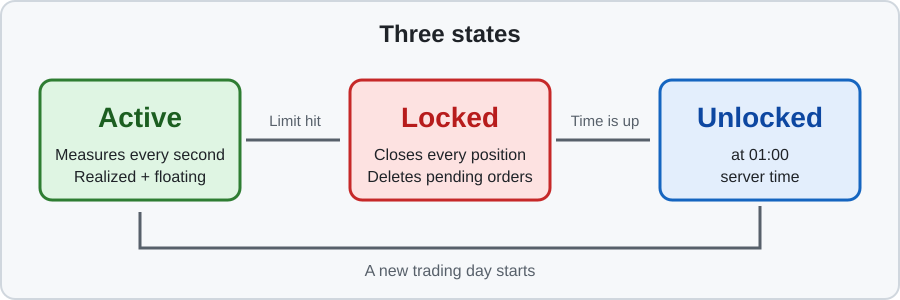
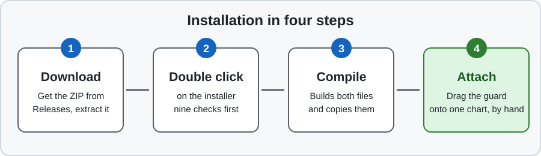
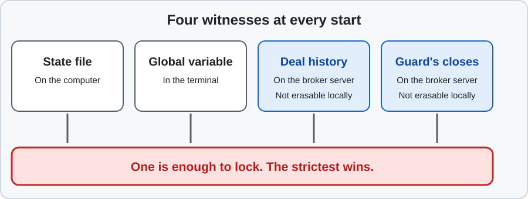

[עברית](README.he.md)

# 🛡️ TradeTimeout

**The open-source daily loss lock for MetaTrader 5.**

  

Many traders know how this ends: one bad session, one trade too many, and the daily loss limit is gone. You knew the limit. Knowing it was not enough.

TradeTimeout sits on one chart and watches the whole account. When your daily loss reaches the limit you set, it closes every open position, deletes every pending order, and locks the account until the next trading day starts.

## 🎬 What it looks like

Illustration: the loss reaches the limit, the positions are closed, and the account stays locked until 01:00.

Installation: download, double click, and the installer compiles and copies two files to the terminal: the guard and the alerts service.

Attaching to a chart: every time it is attached and every time it starts, the guard checks four witnesses, and only then starts measuring.

## ✋ What it does

Three rules. That is all.

1. 🔒 When you reach the daily loss limit, the account locks until 01:00 server time.
2. 🧹 A lock closes every position and deletes every pending order. That includes anything opened from your phone.
3. 🔁 Restarting the terminal or deleting files does not release the lock.

The limit covers the whole account. Not one trade and not one strategy. Every trade counts, whoever opened it: you, another Expert Advisor or your phone.

You choose two values: a percentage of the balance at the start of the day, and a fixed amount in the account currency. The smaller of the two applies. Both the realized profit and loss and the floating result of the open positions are counted.

The trading day starts at 01:00 server time. No setting moves it.

## 🚫 What it never does

* It never opens trades of its own. It only closes and deletes, and only while locked.
* It does not touch other Expert Advisors. It does not switch them off and does not change them. While locked it does close their positions too, because the limit covers the whole account.
* The guard itself does not use the network. It has no internet connection of its own. What it sends goes only through the terminal to your broker: close and delete orders, while locked. The alerts service, if you add it, is a separate program: it sends messages to Telegram and a heartbeat ping to a monitoring service, and it has no way to change anything in the guard.

## ⚠️ What it cannot do

A guard that runs on your computer stops when the terminal is closed or the guard is removed. TradeTimeout makes breaking your own rule slow and deliberate. It cannot make it impossible.

It is a discipline tool. It does not give trading advice, and it does not promise that you will pass a challenge.

## 📥 Installation

You need Windows, and MetaTrader 5 opened at least once under this Windows account. Installing MetaTrader is not enough, because the installer finds the terminal by the folder that the first launch creates.

Names: the product is called TradeTimeout. Inside MetaTrader, in the installer and in its alert pop-ups the guard appears under its original name, AccountGuardian. The Telegram messages call it "the guardian". Folders and files carry the original name too.

1. Download [`TradeTimeout-installer.zip`](https://github.com/www8351/AccountGuardian-Release/releases/latest/download/TradeTimeout-installer.zip). It is the file attached to the latest release, on the `Releases` page of this repository.
2. Extract the whole file into one folder. Do not run anything from inside the compressed file.
3. Close MetaTrader 5 and `MetaEditor`. The installer does not close them for you.
4. Double click `installer\install.cmd`. If there are several terminals, type the number of the right one.
5. The installer runs nine checks, compiles the guard and the alerts service, and copies both into the terminal. Every stage is written to `installer\install-log.txt`.

Then attach the guard manually:

1. Open MetaTrader 5 and log in to the trading account.
2. The `Algo Trading` button in the toolbar must be green. Without it the lock still holds, but the guard cannot close anything.
3. In the `Navigator` window, under `Expert Advisors`, drag `AccountGuardian` onto one chart. Any symbol, any timeframe.
4. In the settings window choose the two limits. The default is the highest value in each list: `5.50` percent and `200` in the account currency.
5. In the `Experts` tab read the `limits accepted` line before you restart the terminal. If the guard was refused, the terminal restarts with no guard at all.

## 🔄 Upgrade

Download the new version from the same link, extract it into a new folder, and run `installer\install.cmd` again. The installer recognizes an existing installation, replaces the two files and tells you it is an upgrade.

The installer replaces files only. What already runs in the terminal keeps running the old build until you restart it:

1. The guard: remove it from its chart and attach it again.
2. In the `Experts` tab read `init|build=` and `limits accepted` before you restart the terminal. A refused guard is taken off the chart, and after a restart the terminal comes up with no guard at all.
3. The alerts service, if installed: right click it under `Services`, choose `Stop`, then `Start`.

The installer does not delete or overwrite anything it does not recognize. If it finds a file it does not recognize in its folder, it stops and shows its name.

## 🗑️ Uninstall

The installer does not uninstall. Remove it manually, in this order:

1. Remove `AccountGuardian` from the chart, then stop and remove `AccountGuardianAlerts` under `Services`.
2. Close MetaTrader 5.
3. In the terminal data folder delete the folder `MQL5\Experts\AccountGuardian` and the file `MQL5\Services\AccountGuardianAlerts.ex5`. Open the data folder from inside the terminal, with `File` and then `Open Data Folder`.

Do not uninstall while locked. Once it is removed, nothing closes new positions, and the limit no longer protects the account.

## 📨 Telegram alerts, optional

The alerts service is a separate program that runs next to the guard in the same terminal. It sends a Telegram message for every important event: start and stop, lock and release, a Manual Lockout when it starts and when it ends, algo trading blocked, a disconnect from the broker, and approaching the limit. The messages come in English or in Hebrew, as you choose. A status message arrives every four hours, and you can ask for one at any moment. The guard works without the service, and nothing in the service can release a lock or change a limit.

What to prepare:

1. A Telegram bot. Open `@BotFather`, send `/newbot`, and keep the token it returns.
2. The chat id. Send any message to your bot. In a browser open the address `https://api.telegram.org/bot`, directly after it the token, and after that `/getUpdates`, and copy the number after `"chat":{"id":`.
3. An external heartbeat check. In `healthchecks.io` create a new check with a period of one minute and a grace time of four minutes, connect Telegram to it under `Integrations`, and copy its ping URL. If the guard, the terminal or the computer goes silent, the alert comes from there within about five minutes.
4. The allowed addresses in the terminal. In `Tools`, `Options`, on the `Expert Advisors` tab, tick `Allow WebRequest for listed URL` and add exactly two addresses: `https://api.telegram.org` and `https://hc-ping.com`.

Starting it:

1. In the `Navigator` window, under `Services`, right click `AccountGuardianAlerts` and choose `Add Service`.
2. On the `Inputs` tab paste the token into `TelegramToken`, the chat id into `TelegramChatId` and the ping URL into `NetworkHeartbeatUrl`. The fourth input, `TelegramLanguage`, sets the language of the alerts: `English`, which is the default, or `Hebrew`.
3. Do not click `Save`. Click `OK`, and if the service did not start running, right click it and choose `Start`.
4. In the journal read the line `alerts service started` with `telegram=on` and `network_heartbeat=on`, and the line `alerts language|set=en` (`set=he` for Hebrew). A field left empty turns off only its own channel.

To get the status at any moment, send your bot, from your chat, one of these four texts, exactly as written:

* `status`
* `Status`
* `/status`
* `בדוק אותי`

It is the only command, and it only reads. The reply comes in the language chosen in `TelegramLanguage`, whichever of the four texts you sent. Allow up to about a minute for the reply.

Good to know:

* The token and the ping URL are secrets. Do not save a settings file or a template while they are entered, and do not send them to anyone. Whoever holds the token can read the status messages.
* One service per terminal. Two services will send every message twice.
* To change a value: stop the service, open its settings, change it, and start it again.

## 🔒 When it locks, and what you see

The moment today's profit and loss, realized and floating together, falls to the limit, the account locks. Even if you closed trades at a profit today and then gave back from the peak more than the limit, it locks.

What you see:

* An alert window pops up in the terminal, with the release time.
* A label appears on the chart with the state `LOCKED`.
* The positions are closed one after the other, the biggest loser first, and then the pending orders are deleted. Every attempt is written in the `Experts` tab.

The lock ends at 01:00 server time, and only time ends it. There is no button and no setting that releases it. If the price feed was frozen at the moment of the breach, the lock lasts one more full trading day.

One case is not recovered, and we say so openly: a lock triggered by giving back profit, when there was nothing to close or every close was blocked, and today's realized profit is now above the day's peak minus the limit, does not come back after a restart if both the state file and the global variable were deleted too.

## ⏸️ Manual Lockout

You can lock the account yourself, for a time you choose, from the chart the guard runs on. A Manual Lockout closes the positions and deletes the pending orders exactly like a loss lock, and it cannot be cancelled or shortened.

How to lock:

1. In the top right corner of the chart click `Manual Lockout`.
2. Choose when the lockout ends: `15 minutes`, `30 minutes`, `1 hour`, or `End of session`, until the start of the next trading day. You can also type a number of minutes and click `Custom`, or type an end time in server time as `HH:MM` and click `End time`.
3. Check the summary: the account number, the end time and what will be closed. Click `Lock Account` to lock, or `Back` to go back. The `Lock Account` button becomes active only 3 seconds after the summary opens. If you do not click within a minute, the summary closes by itself.

Good to know:

* A Manual Lockout ends at the latest at the start of the next trading day, at 01:00 server time.
* You can extend a Manual Lockout that is already running, with `Extend`, only to a later time and only up to the start of the next trading day. You cannot shorten it.
* If the guard closes a position during the lockout, the account stays locked until the start of the next trading day.
* If a loss lock is active at the same time, the lock that ends later is the one that counts.
* The lockout survives closing and restarting the terminal, and the chart shows how much time is left.
* The guard enforces the lockout only while the terminal is open and the guard runs on the chart.
* If the guard is off and you delete manually both the Manual Lockout file and its global variable, a Manual Lockout during which the guard closed no position does not come back.

## ❓ Questions and answers

**Why did it not close my position?**
If the account is not locked, it closes nothing. If it is locked, look at the `Experts` tab. The line `sweep blocked` means algo trading is off. The value `class=hold` means the platform refused, for example because the market is closed, and it will try again when the situation changes. And when the terminal is closed or disconnected, it can do nothing until it is back.

**I raised the limit in the middle of the day and it still uses the old one. Why?**
On purpose. Within a day the limit only goes down. A lower limit takes effect at once. A higher one waits for the next 01:00 and is logged with a warning. Otherwise every bad day would end with typing a bigger number.

**What happens if the terminal crashes in the middle of the day?**
On startup it waits for the deal history to settle, goes over today's deals again from the server, and if the day breached the limit it locks again. Even if the loss has already recovered, because what counts is the low point and not the amount at the end. Trades made from the phone while the terminal was closed are counted too.

**Can I release a lock by deleting files or reinstalling?**
No. The files on the computer only speed up detection. The authority is the deal history on the broker's server, and you cannot delete that from the computer. The two cases described above are the exceptions. Deleting files together with raising the limit is a known gap, and the limit never goes above `5.50` percent and `200` anyway.

**Does it also work on trading from the phone or from another Expert Advisor?**
Yes. It measures the whole account, whoever opened the trade.

## 🧪 Demo first

Install on a demo account first, and let it run for at least one full trading day, preferably a weekend too. Look at the `Experts` tab and see the day change at 01:00, the move from `SYNCING` to `ACTIVE` after a restart, and the numbers following the account. Note: the first attach to an account that already went past the limit today locks it at once, and closes all the positions in the account, including those opened by other Expert Advisors or from your phone.

## 🤝 Works with

Works with any broker that offers MetaTrader 5 on Windows.

## 🔭 What comes next

A paid layer may follow for traders who want a witness: one screen for all your accounts, and a person you choose who gets a message when the guard goes quiet. The free guard stays free and open.

[Join the waitlist](https://tradetimeout.com)

## 📄 License

MIT license. The full text is in the `LICENSE` file.
